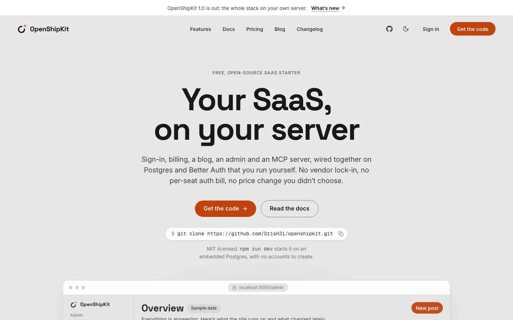
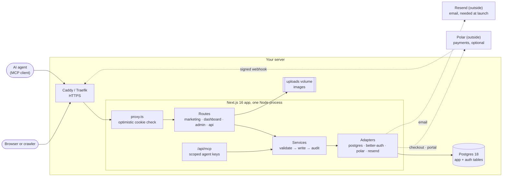
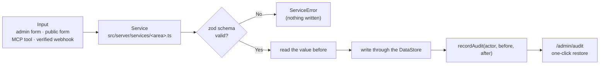
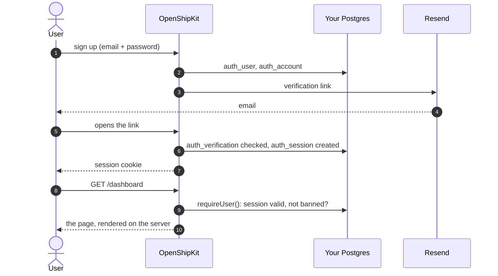
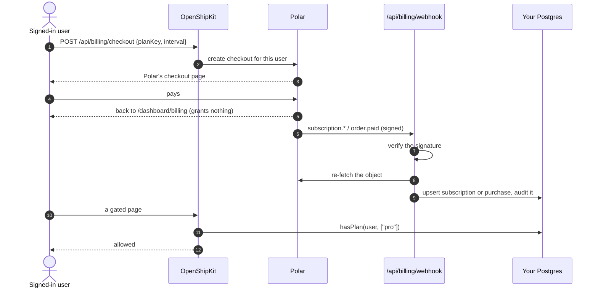
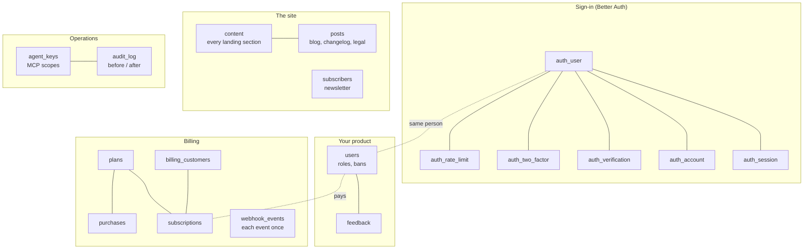
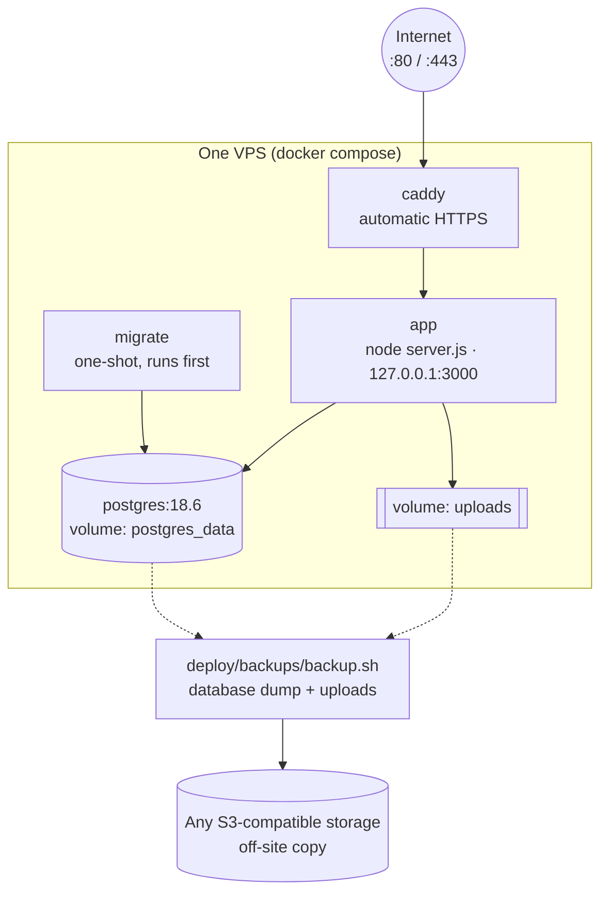
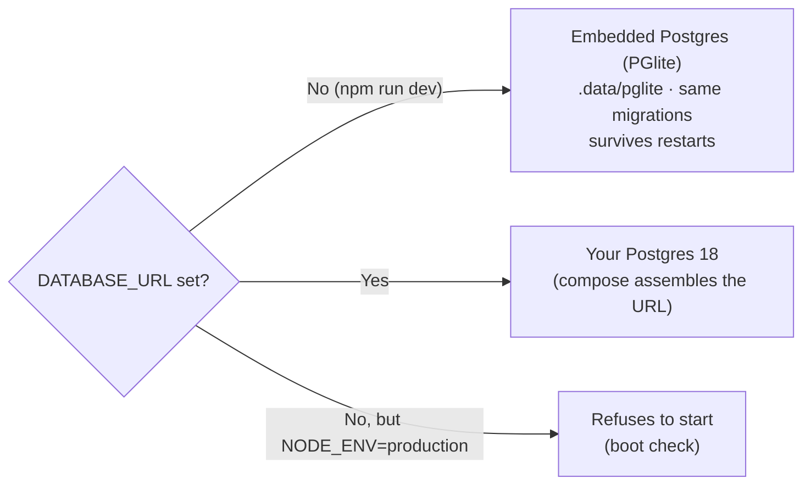
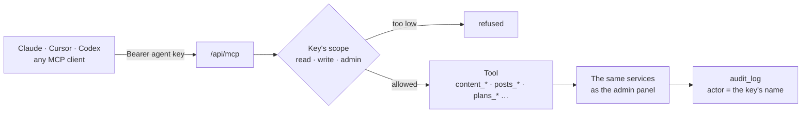
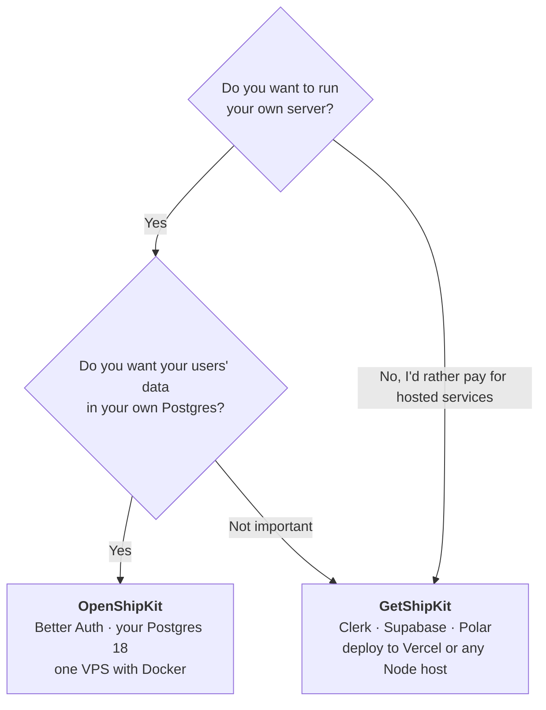

# OpenShipKit

**The free, open-source SaaS starter you run on your own server.**
Next.js 16, Postgres, Better Auth — no auth company, no database company, no
lock-in. Landing page, blog, admin, billing and a built-in MCP server so AI
agents can run the whole site. MIT licensed.

**[Docs](docs/README.md)** ·
**[Set it up with an AI agent](docs/ai-setup.md)** ·
[Changelog](CHANGELOG.md) ·
[DRISH LABS apps](https://drishlabs.com/apps)

**See it running in a minute:** clone it and run `npm run dev` (no accounts, no env). There
is no hosted demo: the app runs on your machine with sample data, admin included.

[](LICENSE)
[](https://github.com/DrisH31/openshipkit/actions/workflows/ci.yml)


```bash
git clone https://github.com/DrisH31/openshipkit.git my-saas
cd my-saas && npm install && npm run dev     # no env, no accounts, no database server
```

<picture>
  <source media="(prefers-color-scheme: dark)" srcset="docs/images/landing-dark.webp">
  
</picture>

<!-- TODO(screenshots): add /admin and /dashboard (light + dark), captured
     from a fresh `npm run dev` database (no test accounts in the lists), at
     1440 px as WebP under docs/images/. Real captures only, no mock-ups. -->

---

## Contents

- [Why OpenShipKit](#why-openshipkit) · [Features](#features) · [How it works, in diagrams](#how-it-works-in-diagrams)
- [The 60-second demo](#the-60-second-demo) · [Set it up with an AI agent](#set-it-up-with-an-ai-agent) · [Production in 5 minutes](#production-in-5-minutes) · [MCP in 30 seconds](#mcp-in-30-seconds)
- [Project structure](#project-structure) · [Scripts](#scripts) · [Deployment](#deployment) · [Documentation](#documentation)
- [OpenShipKit or GetShipKit?](#openshipkit-or-getshipkit) · [What OpenShipKit doesn't do (yet)](#what-openshipkit-doesnt-do-yet) · [Contributing](#contributing) · [License](#license)

## Why OpenShipKit

Most SaaS starters are a thin layer over five hosted services: one for auth,
one for the database, one for email, one for analytics, one for payments.
Each has its own dashboard, pricing page and outage. OpenShipKit is one app:

- **Independent.** Your Postgres, your auth (Better Auth, in the app, tables in
  your database), your server. Email goes through **Resend** or any **SMTP**
  server, your own included, and **Polar** takes payments (optional). The app
  starts without email (it goes to the server log), but in production nobody can
  verify an address or reset a password until one is set, so treat it as needed
  for launch.
  An opt-in module can add an AI provider, and that can be your own server too.
- **Self-hosted in one command.** `docker compose --profile https up -d` on any
  VPS gives you Postgres 18, migrations, the app and automatic HTTPS. Or Dokploy,
  Coolify, or plain `node server.js` under systemd.
- **Zero-config demo.** With no `DATABASE_URL`, development runs on an
  **embedded Postgres** (PGlite) in `.data/pglite` — real Postgres, the same
  migrations, data that survives restarts.
- **AI-agent native.** A built-in MCP server at `/api/mcp` lets Claude, Cursor or
  any MCP client edit content, write posts, manage plans and triage feedback —
  through the same validated, audited write path as the admin.
- **SEO-first.** Every public page is server-rendered with its content in the
  first byte, JSON-LD, sitemap, RSS, `robots.txt` and `llms.txt`.
- **Readable.** A short [SPEC](SPEC.md), one write path, one stack. Built to be
  understood by people and by coding agents ([AGENTS.md](AGENTS.md)).

## Features

| Area | What you get |
|---|---|
| **Marketing site** | Landing page (hero, features, steps, stats, testimonials, pricing, FAQ, latest posts, CTA), pricing page, contact form, newsletter sign-up, legal pages — every section editable in the admin |
| **Blog + changelog** | Markdown posts with tags, cover images, table of contents, RSS feeds, per-post Open Graph images; drafts, and unlisted posts (live at their URL and in the sitemap, off the lists) |
| **Auth** | Better Auth: email + password, email verification, password reset, magic links, two-factor (TOTP + backup codes), session management, optional GitHub / Google |
| **Dashboard** | Home (with a setup checklist for admins), billing, profile, password, 2FA, sessions, delete account, feedback |
| **Admin** | Overview, users (roles, bans), content editor, posts, media library (image uploads on your own disk), plans, feedback inbox, subscribers (CSV export), agent keys, audit log (one-click restore for content, posts and plans) |
| **Billing (optional)** | Polar as merchant of record: checkout, customer portal, signature-verified idempotent webhooks; access granted only from webhooks |
| **Email** | Resend or any SMTP server (your own included) in production; in development every email prints to the terminal |
| **MCP server** | 30+ tools over Streamable HTTP, scoped agent keys (read / write / admin), every write audited (reads update the key’s last-used time) |
| **SEO** | Server-rendered pages, canonical URLs, JSON-LD, sitemap, RSS, `robots.txt` open to search and AI crawlers, `llms.txt` + `llms-full.txt`, generated OG images, optional IndexNow pings |
| **Design system** | Tailwind 4 tokens, shadcn/ui on Base UI, CSS motion that honours `prefers-reduced-motion`; light + dark; WCAG 2.2 AA; one brand colour to change |
| **Ops** | Dockerfile, docker compose with Caddy, health check, JSON logs, optional error tracking (GlitchTip or any Sentry DSN, no SDK), smoke and end-to-end tests, backups of the database and uploads with restore rehearsal, CI with a real Postgres |
| **Opt-in modules** | AI chat and images behind spend controls, per-person document search (RAG on pgvector), Redis for more than one replica — tested, off until you enable one ([modules/](modules/README.md)) |

## How it works, in diagrams

The details live in [docs/architecture.md](docs/architecture.md) and the guides it links. These are
the pictures to read first.

### The pieces

One Next.js app. Pages read Postgres directly; one set of services is the only way data changes;
each outside SDK sits behind one adapter.



### Every change takes one path

An admin saving the hero, a visitor's contact form, an agent publishing a post and a webhook
recording a subscription all go through the same steps, so every write is validated and audited.



### Signing in

Better Auth runs inside the app: sessions, users and two-factor secrets are rows in your Postgres.



### Taking money

Access comes only from verified webhooks: never from the checkout redirect, a query string or the
browser.



### What's in the database



### Running it in production

`docker compose --profile https up -d` starts all of this on one machine. Only Caddy's ports are
public; everything else binds to `127.0.0.1`.



### Development and production use the same Postgres code



### AI agents run the site through the same rules



## The 60-second demo

```bash
git clone https://github.com/DrisH31/openshipkit.git my-saas
cd my-saas
npm install
npm run dev
```

Open <http://localhost:3000>. No `.env`, no Docker, no accounts. The app starts
an embedded Postgres in `.data/pglite`, applies the migrations and seeds plans
and posts. Sign up with any email (emails, including verification links, print
in the terminal).

To see the admin, write your env file and name yourself an admin:

```bash
npm run setup -- --admin-email you@example.com   # writes .env.local with generated secrets
npm run dev                                      # sign up with that email → /admin
```

Starting a real site? Start from a release tag rather than `main`, and write
down which one:

```bash
npx degit DrisH31/openshipkit#v1.0.0 my-site      # files at that release, no history
```

[docs/releasing.md](docs/releasing.md) explains the versions and how to pull
later releases. Building a landing page + blog with no SaaS? Add
`npm run setup -- --profile site` ([docs/site-profile.md](docs/site-profile.md)).

Requires Node.js 24 LTS (22.18+ works; older 22.x can’t run
`node scripts/setup.mts`, which needs built-in type stripping). The embedded
database allows one process at a time — stop `npm run dev` before
`npm run db:migrate` or `npm run mcp:key` against it.

## Set it up with an AI agent

OpenShipKit is written to be set up by a coding agent as well as by hand.
[AGENTS.md](AGENTS.md) and [SPEC.md](SPEC.md) give the agent the rules,
`npm run check`, `smoke` and `e2e` let it prove each step worked, and once the
site runs, the agent edits copy, posts and plans through the site’s own MCP
server. [docs/ai-setup.md](docs/ai-setup.md) is a pack
of copy-paste prompts for Claude Code, OpenCode, Cursor or Codex, one per step
and in order:

1. Clone, run locally, verify
2. Make it yours: name, copy, plans and brand colour, through the site’s MCP server
3. Email with Resend, DNS records included
4. Point your domain at the server
5. Deploy: docker compose + Caddy on a VPS, Dokploy or Coolify
6. Payments with Polar, sandbox first
7. Backups and a restore rehearsal
8. The go-live checklist
9. Daily operation through MCP

Each prompt says what the agent must not do: no secrets in git or in the chat,
and it asks before pushing, deploying or changing DNS. The page also lists
optional MCP servers that make an agent faster (Cloudflare, Dokploy, Coolify,
GitHub, Polar, Resend), and the guardrails to use with them.

## Production in 5 minutes

On any Linux server with Docker, and a domain pointing at it:

```bash
git clone https://github.com/<you>/<your-fork>.git /opt/openshipkit && cd /opt/openshipkit
docker run --rm -v "$PWD":/app -w /app --user "$(id -u):$(id -g)" node:24.21.0-alpine3.24 \
  node scripts/setup.mts --compose --domain example.com --admin-email you@example.com
docker compose --profile https up -d --build
```

That starts Postgres 18, runs the migrations and seed once, starts the app,
and puts Caddy in front with a Let’s Encrypt certificate for `example.com`.
Compose reads **`.env`** (not `.env.local`). Then:

```bash
npm run smoke -- https://example.com     # from your laptop: pages, feeds, health, MCP 401 (--mcp-key for tools)
```

To update later: `git pull`, then
`docker compose --profile https build && docker compose run --rm migrate && docker compose --profile https up -d`
— migrations run while the old app still serves, and a failed one stops the
update before the app is replaced.

Full walkthrough — firewall, Docker, DNS, updates, logs — in
[deploy/vps/](deploy/vps/README.md). Turn on email (`RESEND_API_KEY`) before real
users sign up: production requires verified email.

## MCP in 30 seconds

Every OpenShipKit site is an MCP server at `/api/mcp`.

1. Sign in as an admin → **/admin/agents** → create a key (or `npm run mcp:key -- --name "Claude Code"`).
   In development, `npm run setup` already put an `MCP_DEV_KEY` in `.env.local`.
2. Connect a client. Claude Code:

   ```bash
   claude mcp add --transport http openshipkit https://example.com/api/mcp \
     --header "Authorization: Bearer osk_…"
   ```

   This repository also ships a `.mcp.json` (Claude Code) and an `opencode.json`
   ([OpenCode](https://opencode.ai)) for local development: export `OPENSHIPKIT_MCP_KEY`
   (your key or `MCP_DEV_KEY`) and open the folder in either.
3. Ask: *“Rewrite the hero for indie developers and draft a launch post.”*
   Changes are live as soon as a call returns. Every one is logged in `/admin/audit`
   under the key’s name, and content, posts and plans can be restored from there
   (or with the `audit_restore` tool).

OpenCode, Cursor, Claude Desktop, VS Code, Codex, scopes and the full tool list: [docs/mcp.md](docs/mcp.md).

## Project structure

```
src/
  app/                Routes only — pages compose components, handlers call services
    (marketing)/      /, /pricing, /blog, /changelog, /legal/[slug], /contact
    (auth)/           /sign-in, /sign-up, /auth/[page] (reset, verify, magic link, 2FA)
    dashboard/        the signed-in product
    admin/            role=admin: content, posts, media, plans, users, feedback, agents, audit
    api/              auth, billing (checkout, portal, webhook), mcp, forms, health, media upload, IndexNow key
    uploads/          uploaded images, served from UPLOADS_DIR
  core/               contracts, domain types, zod schemas — no I/O
  server/             server-only: env, registries, session, rate limits
    services/         THE write path: validate → DataStore → audit log
    mcp/              the MCP server: protocol + tools over services
  adapters/           the only place a driver or SDK is imported
    auth/better-auth/ · data/postgres/ · data/memory/ · billing/polar/ · email/{resend,smtp,console}/
  components/         ui/ (shadcn on Base UI) · marketing/ · sections/ · product/ · blog/ · seo/ · …
  content/            default content and seed data
  styles/             design tokens (tokens.css), brand colour (brand.css), prose
drizzle/              generated SQL migrations
modules/              opt-in modules (AI, RAG, Redis): tested, off until you enable one
scripts/              setup, db-migrate, seed, mcp-key, smoke, e2e, ds-sync
deploy/               VPS + Caddy, Dokploy, Coolify, plain Node, backups, hardening
docs/                 guides for people and agents
tests/                Vitest (contract tests run on memory and, with TEST_DATABASE_URL, Postgres)
```

[docs/architecture.md](docs/architecture.md) explains how the pieces fit.

## Scripts

| Command | What it does |
|---|---|
| `npm run dev` | Dev server on :3000 (embedded Postgres when `DATABASE_URL` is unset) |
| `npm run build` | Production build (`.next/standalone`) — needs no environment |
| `npm start` | Serve the production build: copies static assets into `.next/standalone` and runs its `server.js` with `.env`/`.env.local` loaded (what the Docker image runs) |
| `npm run setup` | Write `.env.local` (or `.env` with `--compose`) with generated secrets; never overwrites a set value. `-- --profile site` makes it a landing page + blog with no SaaS ([docs/site-profile.md](docs/site-profile.md)) |
| `npm run check` | `typecheck` + `typecheck:modules` + `lint` + `test` — run before every commit |
| `npm run typecheck` | `tsc --noEmit` |
| `npm run typecheck:modules` | Typecheck the opt-in modules on their own (`tsconfig.modules.json`) |
| `npm run lint` | ESLint (Next.js core-web-vitals + TypeScript rules) |
| `npm test` | Vitest |
| `npm run db:generate -- --name <change>` | Write a new SQL migration from `schema.ts` (drizzle-kit) |
| `npm run db:migrate` | Apply pending migrations (Postgres at `DATABASE_URL`, or the embedded one) |
| `npm run db:seed` | Seed a brand-new database with the starter plans and posts, once (later runs add nothing, so deleted starter rows stay deleted); `-- --force` adds back missing ones. Never overwrites edits |
| `npm run db:studio` | Browse the database (drizzle-kit studio; needs `DATABASE_URL`) |
| `npm run mcp:key` | Mint, list or revoke MCP agent keys |
| `npm run smoke -- <url>` | Check a running site from the outside, read-only; `--mcp-key` also tests MCP and unlisted posts, `--indexnow-key` the IndexNow key file |
| `npm run e2e -- <url>` | Drive a running **dev or staging** site end to end — sign up, admin, publish, contact form, MCP — then delete what it made |
| `npm run ds:sync -- --from <path>` | Dry-run (or `--apply`) a sync of tokens and `ui/` components from a design-system repository ([docs/customization.md](docs/customization.md#staying-in-step-with-a-design-system)) |

## Deployment

| Where | Guide |
|---|---|
| Any VPS — docker compose + Caddy (recommended) | [deploy/vps/](deploy/vps/README.md) |
| Dokploy | [deploy/dokploy.md](deploy/dokploy.md) |
| Coolify | [deploy/coolify.md](deploy/coolify.md) |
| Plain Node + systemd, no Docker | [deploy/node/](deploy/node/README.md) |
| Backups (database **and** uploads), off-site copies, restore rehearsal | [deploy/backups/](deploy/backups/README.md) |
| Hardening checklist | [deploy/hardening.md](deploy/hardening.md) |

Which one? [docs/deployment.md](docs/deployment.md#choose-where-it-runs)
compares them; [docs/ai-setup.md](docs/ai-setup.md) has a deploy prompt for
each.

## Documentation

Every guide is in [docs/](docs/README.md). A running copy also serves them at `/docs` while
the site is still named OpenShipKit.

| Guide | |
|---|---|
| [Getting started](docs/getting-started.md) | From clone to your own product |
| [AI setup](docs/ai-setup.md) | Copy-paste prompts that set everything up with a coding agent, and the MCP servers that help |
| [Architecture](docs/architecture.md) | Layers, the write path, request flow |
| [Deployment](docs/deployment.md) | Choosing a host (VPS, Dokploy, Coolify, Node), the image, migrations |
| [Scaling](docs/scaling.md) | What breaks first past one server, and what to do first |
| [Auth](docs/auth.md) | Better Auth features, OAuth, admins, sessions |
| [Data](docs/data.md) | Postgres, Drizzle, migrations, the embedded database, backups |
| [Billing](docs/billing.md) | Optional Polar: products, webhooks, sandbox testing |
| [Email](docs/email.md) | Resend, domain verification (SPF, DKIM, DMARC) |
| [Content](docs/content.md) | Editable sections, posts (draft, unlisted), the media library, legal pages |
| [Customization](docs/customization.md) | Brand colour, copy, pages, sections, design-system sync |
| [Content site](docs/site-profile.md) | Landing page + blog, no SaaS |
| [SEO](docs/seo.md) | Metadata, JSON-LD, sitemap, robots, llms.txt, the rules that cost traffic |
| [MCP](docs/mcp.md) | Agent keys, clients, tools |
| [Modules](docs/modules/README.md) | Opt-in AI, document search (RAG) and Redis, off until enabled |
| [Security](docs/security.md) | The security model |
| [Observability](docs/observability.md) | Structured logs, optional self-hosted error tracking, health |
| [Upgrading](docs/upgrading.md) | Pulling template updates, Next.js patches, Postgres majors |
| [Releasing](docs/releasing.md) | Branches, versions, tags; starting a site from a release |
| [Troubleshooting](docs/troubleshooting.md) | Common errors and fixes |

## OpenShipKit or GetShipKit?

Two starters from the same author, for opposite choices.
[GetShipKit](https://github.com/DrisH31/GetShipKit) is the sibling
built on hosted services; OpenShipKit is the one you run yourself.



| | **OpenShipKit** | **GetShipKit** |
|---|---|---|
| **The idea** | Own everything: one app on your own server | Rent the hard parts: hosted auth and a hosted database |
| **Auth** | Better Auth inside the app; users in your Postgres | Clerk (hosted) |
| **Database** | Your own Postgres 18 (embedded Postgres in development) | Supabase (hosted Postgres) |
| **Payments** | Polar (optional) | Polar |
| **Email** | Resend (needed at launch: sign-up verification and password resets) | Sign-in emails sent by Clerk |
| **Where it runs** | Your VPS: Docker Compose + Caddy, Dokploy or Coolify | Vercel or any Node.js host |
| **To run it locally** | Nothing: no accounts, no env, `npm run dev` | Clerk and Supabase accounts and keys first |
| **Who holds user data** | You (and Polar, for billing, if payments are on) | Clerk, Supabase and Polar |
| **You look after** | The server: updates, backups, restores | Three services' keys, dashboards and plans |
| **Included** | Landing page, dashboard, billing, feedback, newsletter, tests and CI, plus blog, admin, media library, MCP server for AI agents, audit log, backups | Landing page, dashboard, billing, feedback, newsletter, legal page outlines, tests and CI |
| **Pick it if** | You want your users' data and your costs in your own hands | You'd rather not run a server or a database |

They share no code. Moving a GetShipKit project here is a rebuild, not an
upgrade: [docs/upgrading.md](docs/upgrading.md#coming-from-getshipkit).

## What OpenShipKit doesn't do (yet)

Honest limits, so you know what you'd add:

| Not included | What that means for you |
|---|---|
| More than one language | Every word is English; there's no locale switch |
| Teams and organisations | Accounts are single people: no organisations, seats or SSO (roles are admin and user) |
| Payment providers other than Polar | Stripe or Razorpay means a new billing adapter |
| More than one app replica out of the box | Turn on the Redis module first ([modules/](modules/README.md)) |
| Someone to look after the server | Updates, backups and restore rehearsals are yours ([deploy/](deploy/README.md)) |

Want the hosted version instead? See [GetShipKit](https://github.com/DrisH31/GetShipKit).

## Contributing

Issues and pull requests are welcome. Read [CONTRIBUTING.md](CONTRIBUTING.md)
(setup, the rules, how to run the Postgres tests) and the
[Code of Conduct](CODE_OF_CONDUCT.md). Security issues: please report privately
([SECURITY.md](SECURITY.md)).

## License

**MIT**: free for any use, commercial or personal. Build and sell products with it, use it at
work or for clients, change it, and keep your changes private. The only condition is keeping the
copyright notice in [LICENSE](LICENSE) with the code. Crediting OpenShipKit on your site is
appreciated, not required. It comes with no warranty.

---

OpenShipKit is **a [DRISH LABS](https://drishlabs.com) project**, listed with the studio's
other apps at [drishlabs.com/apps](https://drishlabs.com/apps). It has no website of its own:
this repository is its home.
